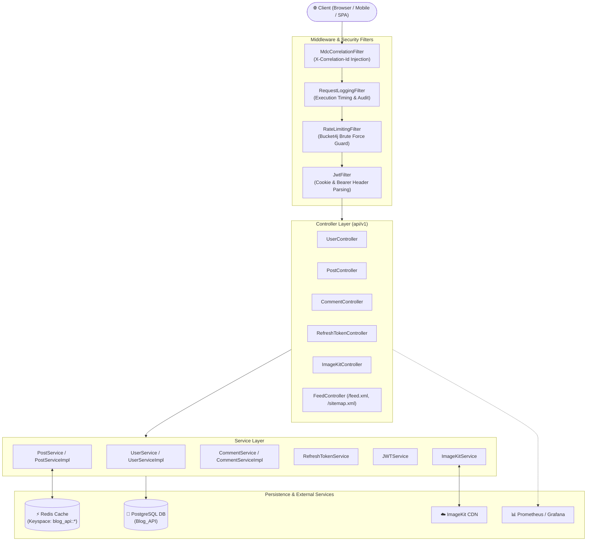
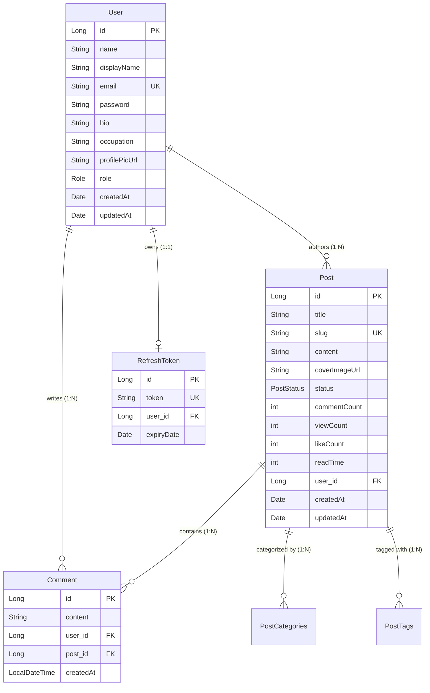
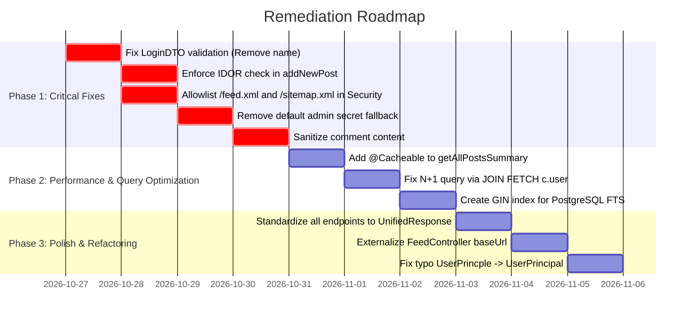

# 🔍 End-to-End Codebase Analysis: BlogV2 API

A comprehensive technical evaluation of the **BlogV2** backend application covering architecture, domain design, security posture, business logic, caching, observability, and identified vulnerabilities.

---

## 1. Executive Summary & Tech Stack Overview

**BlogV2** is a modular RESTful blogging and content management backend built on **Java 17** and **Spring Boot**. It incorporates modern engineering practices including stateless dual-token authentication (JWT + HttpOnly Cookie rotation), multi-tiered Redis caching, OWASP rich-text sanitization, ImageKit CDN image transformations, and an observability stack (Micrometer, Prometheus, Grafana, Logstash JSON logging with MDC tracing).

### Technology Inventory
| Component | Technology / Library | Purpose |
| :--- | :--- | :--- |
| **Language & Runtime** | Java 17 / 21 | Core programming language |
| **Framework** | Spring Boot (WebMVC, Data JPA, Security, Actuator) | Core application framework |
| **Relational Database** | PostgreSQL 15+ | Primary persistent data store |
| **Caching Layer** | Redis 7 (Alpine) + Spring Cache abstraction | In-memory response & entity caching |
| **Object Mapping** | MapStruct `1.5.5.Final` & manual mappers | Compile-time entity ↔ DTO conversions |
| **Security & Auth** | Spring Security 6 / JJWT `0.12.6` / Bucket4j `8.3.0` | JWT authentication, RBAC, and rate limiting |
| **Content Security** | OWASP Java HTML Sanitizer | HTML/Markdown XSS sanitization |
| **Media Management** | ImageKit Java SDK `3.0.0` | Cloud media storage & dynamic URL transformations |
| **DevOps & Observability** | Docker Compose, Prometheus, Grafana, Logstash Logback Encoder | Containerization, metric scraping, structured JSON logging |
| **API Documentation** | Springdoc OpenAPI `2.8.0` | Swagger UI & OpenAPI 3 specification |

---

## 2. High-Level System Architecture



---

## 3. Domain Model & Database Schema Analysis

### Entity Breakdown & Relationships



### Architectural Details in Entities:
1. **User Entity (`com.API.BlogV2.Entity.User`)**:
   - Uses `AllocationSize = 1` sequence `user_sequence`.
   - Generates a 5-character sanitized `displayName` via `generateDisplayName()` when none is explicitly provided.
   - Bidirectional relationship with `Post` marked with `@JsonIgnore` to avoid circular serialization.
2. **Post Entity (`com.API.BlogV2.Entity.Post`)**:
   - Unique index on `slug` (`idx_post_slug`).
   - Supports publication states via `PostStatus` (`DRAFT`, `PUBLISHED`, `ARCHIVED`).
   - Stores categories (`CategoryType` enum) in table `post_categories` and tags (`String`) in table `post_tags` using `@ElementCollection(fetch = FetchType.EAGER)`.
   - Maintains denormalized counters: `commentCount`, `viewCount`, `likeCount`, and estimated `readTime`.
3. **Comment Entity (`com.API.BlogV2.Entity.Comment`)**:
   - `@Size(min = 3, max = 100)` validation on `content`.
   - Belongs to both `User` and `Post` via `@ManyToOne(fetch = FetchType.LAZY)`.
4. **RefreshToken Entity (`com.API.BlogV2.Entity.RefreshToken`)**:
   - Uses `GenerationType.IDENTITY` (unlike Sequence generator used in Post/User/Comment).
   - Maps `OneToOne` to `User`.

---

## 4. Security & Authentication Deep Dive

### Dual-Token Lifecycle (JWT + Cookie Rotation)
The project replaces traditional local storage JWT persistence with **HttpOnly cookies** to mitigate Cross-Site Scripting (XSS) token theft:

1. **Login Flow (`UserController.login`)**:
   - Authenticates credentials via Spring's `AuthenticationManager`.
   - Issues short-lived Access Token (15 minutes) signed with HMAC-SHA256 (`jjwt`).
   - Issues long-lived Refresh Token (7 days) stored in PostgreSQL.
   - Dispatches both via `Set-Cookie` header (`HttpOnly`, `SameSite=Lax`, `Path=/`).
2. **Token Extraction (`JwtFilter.doFilterInternal`)**:
   - Dual-source resolution: Checks incoming request `Cookie` header for `accessToken`; falls back to standard `Authorization: Bearer <token>` for API clients (Postman, curl).
3. **Token Refresh & Rotation (`RefreshTokenController.refreshToken`)**:
   - Reads `refreshToken` cookie.
   - Deletes existing refresh token from DB (`deleteByUser`), preventing replay attacks.
   - Generates brand new access and refresh tokens, setting updated cookies on the response.
4. **Logout Flow (`UserController.logout`)**:
   - Deletes refresh token row from database.
   - Overwrites browser cookies with `maxAge=0`.

---

## 5. API Layer & Controller Design

Endpoints conform to a standard envelope wrapper **`UnifiedResponse<T>`**:

```json
{
  "success": true,
  "message": "Post retrieved successfully",
  "data": { ... },
  "timestamp": "2026-10-26T19:00:00.000"
}
```

### Endpoints Matrix
| Resource | Method | Path | Auth / Role | Description |
| :--- | :--- | :--- | :--- | :--- |
| **Auth** | `POST` | `/api/v1/auth/register` | Public | Registers a new user account |
| | `POST` | `/api/v1/auth/login` | Public (Rate-limited) | Verifies credentials, issues auth cookies |
| | `POST` | `/api/v1/auth/refreshtoken` | Public (Cookie) | Rotates refresh token & issues new access token |
| | `POST` | `/api/v1/auth/logout` | Authenticated | Clears database token & invalidates cookies |
| **Users** | `GET` | `/api/v1/users` | `ROLE_ADMIN` | List all registered users |
| | `GET` | `/api/v1/users/{id}` | Public | Retrieve user profile by ID |
| | `PUT` | `/api/v1/users/{id}` | Self / `ROLE_ADMIN` | Update user profile bio/occupation/name |
| | `DELETE`| `/api/v1/users/{id}` | Self / `ROLE_ADMIN` | Delete user account |
| | `PATCH` | `/api/v1/users/{id}/profile-pic` | Self / `ROLE_ADMIN` | Update profile avatar URL |
| | `PATCH` | `/api/v1/users/{id}/role` | `ROLE_ADMIN` | Elevate or alter user role |
| **Posts** | `GET` | `/api/v1/posts` | Public | Paginated feed of published post summaries |
| | `GET` | `/api/v1/posts/{slug}` | Public | Full post details by SEO slug + async view counter |
| | `GET` | `/api/v1/posts/id/{post_id}` | Public | Lookup post by numeric ID |
| | `GET` | `/api/v1/users/{userId}/posts`| Public | Paginated posts authored by specific user |
| | `POST` | `/api/v1/users/{userId}/posts`| Authenticated | Create a new blog post |
| | `PUT` | `/api/v1/posts/{id}` | Owner / `ROLE_ADMIN` | Update post content/title/status |
| | `DELETE`| `/api/v1/posts/{id}` | Owner / `ROLE_ADMIN` | Remove post |
| | `GET` | `/api/v1/posts/search/{keyword}`| Public | Full-text search on title/content |
| | `GET` | `/api/v1/posts/category/{cat}`| Public | Filter posts by category |
| | `GET` | `/api/v1/posts/tags/{tag}` | Public | Filter posts by tag |
| | `POST` | `/api/v1/posts/{id}/like` | Authenticated | Increments post like counter |
| | `PATCH` | `/api/v1/posts/{id}/cover-image`| Owner / `ROLE_ADMIN` | Update post cover image URL |
| **Comments**| `GET` | `/api/v1/posts/{id}/comments`| Public | Fetch comments for a post |
| | `POST` | `/api/v1/posts/{id}/comments`| Authenticated | Add comment to post |
| | `PUT` | `/api/v1/posts/{pId}/comments/{cId}`| Author Only | Update comment content |
| | `DELETE`| `/api/v1/posts/{pId}/comments/{cId}`| Author / `ROLE_ADMIN` | Delete comment |
| **Media** | `GET` | `/api/v1/imagekit/auth` | Public | Generates HMAC-SHA1 signature for direct CDN upload |
| **Feeds** | `GET` | `/feed.xml` | Public (Intended) | RSS 2.0 feed of latest posts |
| | `GET` | `/sitemap.xml` | Public (Intended) | XML Sitemap for search engines |

---

## 6. Business Logic, Performance & Caching

### 1. Redis Caching Strategy (`RedisConfig`)
- Custom `RedisCacheManager` configured with `GenericJackson2JsonRedisSerializer` and `JavaTimeModule`.
- Cache TTL: **10 minutes**.
- Keys are namespaced with `blog_api::`.
- Targeted caches:
  - `postBySlug`: Cache for `getPostDetailBySlug(slug)`.
  - `post`: Cache for `getPostById(id)`.
  - `userPosts`: Cache for author's posts list.
  - `postSearch`, `postsByCategory`, `postsByTag`.

### 2. Rich Text Sanitization (`HtmlSanitizerUtil`)
- Prevents stored XSS by sanitizing incoming HTML using OWASP `HtmlPolicyBuilder`.
- Preserves common formatting tags (`p`, `h1-h6`, `blockquote`, `code`, `b`, `i`, `ul`, `ol`, `table`, `a`, `img`), stripping malicious tags (`<script>`, `<iframe>`, `<object>`) and restricting URLs to `http`, `https`, and `mailto`.

### 3. Collision-Free Slug Generation (`SlugGenerator`)
- Normalizes unicode characters, replaces whitespace and special characters with hyphens.
- Queries `postRepository.existsBySlug(slug)` and increments suffix (`-1`, `-2`) on collisions to guarantee unique URLs.

### 4. Dynamic Read Time Calculation (`PostServiceImpl`)
- Strips HTML markup and computes read duration based on an average reading speed of 200 words per minute (`Math.ceil(wordCount / 200.0)`).

---

## 7. Observability, DevOps & Logging

1. **MDC Request Tracing (`MdcCorrelationFilter`)**:
   - Inspects `X-Correlation-Id` on incoming requests; generates a UUID if absent.
   - Puts `correlationId` into SLF4J MDC and reflects it back in response headers.
2. **Structured JSON Logging (`logback-spring.xml`)**:
   - Uses `net.logstash.logback.encoder.LogstashEncoder`.
   - Dual rolling files: `logs/application.log` (INFO+) and `logs/error.log` (ERROR).
3. **Prometheus & Grafana Pipeline (`docker-compose.yml`)**:
   - Spring Actuator exposes `/actuator/prometheus`.
   - Prometheus container scrapes metrics every 5 seconds.
   - Grafana runs on port 3000 to visualize JVM memory, thread pool exhaustion, HikariCP connection stats, and HTTP throughput.

---

## 8. Critical Findings, Bugs & Security Vulnerabilities

Through this end-to-end audit, several architectural issues, bugs, and security risks were identified:

### 🔴 Critical Security Vulnerabilities

1. **IDOR / User Impersonation in Post Creation (`PostController.java:79-88`)**:
   - The endpoint `POST /api/v1/users/{userId}/posts` allows any authenticated user to create a post under **any** `userId` passed in the URL path.
   - **Root Cause**: The controller only has `@PreAuthorize("isAuthenticated()")` and passes `userId` directly to `postService.addNewPost(userId, p)`. It does not verify that `userId == authentication.principal.id`.
   - **Fix**: Either extract user ID directly from `SecurityContextHolder.getContext().getAuthentication().getPrincipal()`, or add `@PreAuthorize("hasRole('ADMIN') or #userId == authentication.principal.id")`.

2. **Login Validation Bug (`Name is required`) (`LoginDTO.java:11-12`)**:
   - `LoginDTO` defines `@NotBlank(message = "Name is required") private String name;`.
   - When the frontend/client sends a standard login payload `{ "email": "...", "password": "..." }`, Spring's `@Valid` in `UserController.login` rejects the request with HTTP 400 (`Validation failed: Name is required`).
   - `UserServiceImpl.verifyUser()` does not even use `name`.
   - **Fix**: Remove `@NotBlank` and the `name` property from `LoginDTO`.

3. **Insecure Rate Limiting IP Resolution & DoS Flaw (`RateLimitingFilter.java:39-65`)**:
   - `getClientIP()` uses `request.getRemoteAddr()`. Behind Docker bridge networks, reverse proxies (Nginx/Cloudflare), or load balancers, `remoteAddr` is identical for all users. Consequently, 10 failed login attempts from one attacker locks out **all** users globally.
   - Cache purge: `if (cache.size() >= 5000) cache.clear();` allows an attacker to flood requests with random spoofed headers, wipe the in-memory cache, and bypass rate limits entirely.
   - **Fix**: Inspect `X-Forwarded-For` header and consider Redis-backed Bucket4j for distributed rate limiting.

4. **Default Admin Secret Exposure (`application.yml:14`)**:
   - `admin.secret` defaults to `default_admin_secret`.
   - In `UserServiceImpl.registerUser()`, if `dto.getAdminSecret()` matches this value, the account is granted `Role.ADMIN`. If deployed without setting the `ADMIN_SECRET` environment variable, anyone registering with `"default_admin_secret"` acquires full admin rights.

5. **XSS Sanitization Gap in Comments (`CommentServiceImpl.java:62-78`)**:
   - While blog post content is passed through `HtmlSanitizerUtil`, comment content in `addComment()` and `updateComment()` is persisted raw without sanitization. An attacker can store XSS payloads (e.g., `<script src=...>` or ``) within the 100-character limit.

---

### 🟡 Performance & Architectural Deficiencies

1. **Uncached Public Feed vs Orphaned Cached Method (`PostServiceImpl.java:97 & 186`)**:
   - The main feed endpoint `GET /api/v1/posts` calls `postService.getAllPostsSummary(pageable)`. This method has **no caching annotations**.
   - Conversely, `postService.getAllPosts(page, size)` has `@Cacheable(value = "allPosts")` but is never called by `PostController`. The application's highest-traffic endpoint completely misses Redis caching.

2. **N+1 Database Query in Post Detail Fetch (`PostServiceImpl.java:133-140`)**:
   - `PostRepository.findBySlugWithTagsAndComments` executes a `LEFT JOIN FETCH` on comments, but does **not** join fetch `comment.user`.
   - In `PostServiceImpl`, iterating over comments and calling `c.getUser().getDisplayName()` lazily queries the `users` table once per comment ($N$ additional queries).
   - **Fix**: Update the repository query to `LEFT JOIN FETCH p.comments c LEFT JOIN FETCH c.user`.

3. **Inaccessible Public Feeds (`/feed.xml`, `/sitemap.xml`) (`SecurityConfig.java:58-83`)**:
   - Neither `/feed.xml` nor `/sitemap.xml` are listed in `.permitAll()`. They are intercepted by `.anyRequest().authenticated()`, resulting in 401 Unauthorized for search engines (Googlebot) and RSS readers.

4. **Inconsistent Response Contracts**:
   - `PostController.getPostById()` returns raw `ResponseEntity<PostResponseDTO>`.
   - `PostController.getCoverThumbnail()` and `UserController.getProfilePicThumbnail()` return `ResponseEntity<Map<String, String>>`.
   - All other endpoints use `UnifiedResponse<T>`. Frontend API consumers expect a consistent `{ success, message, data }` structure across every route.

5. **Hardcoded Frontend Base URL (`FeedController.java:22`)**:
   - `baseUrl` is hardcoded as `http://localhost:5173`. When deployed to staging or production, RSS and sitemap XML links will point to localhost instead of the real domain.

6. **Missing Index for Full-Text Search (`PostRepository.java:68-69`)**:
   - `searchByKeywordFTS` uses `to_tsvector('english', p.title || ' ' || p.content)`.
   - Without a corresponding GIN index (`CREATE INDEX idx_fts ON posts USING gin(to_tsvector('english', title || ' ' || content));`), PostgreSQL performs a sequential table scan on every search.

---

## 9. Comprehensive Quality & Security Scorecard

| Assessment Dimension | Rating | Key Highlights & Observations |
| :--- | :---: | :--- |
| **Architecture & Structure** | **8.5 / 10** | Clean package segregation (Controller, Service, Repository, DTO, Entity, Utils). Good usage of MapStruct, SLF4J, and Spring conventions. |
| **Security & Authentication** | **6.5 / 10** | Strong foundation with HttpOnly Cookie rotation and OWASP sanitizer, but penalized by the IDOR in post creation, login DTO mismatch, default admin secret, and raw comment storage. |
| **Performance & Scalability** | **7.0 / 10** | Redis integration is properly configured with JSON typing, but hampered by an uncached public feed, N+1 comment user loading, and an unindexed PostgreSQL full-text search. |
| **Observability & DevOps** | **9.0 / 10** | Excellent setup: Docker Compose, Actuator, Micrometer Prometheus scraping, Grafana readiness, and structured JSON logs with MDC correlation tracing. |
| **API Contract Consistency** | **7.5 / 10** | Well-designed `UnifiedResponse<T>` pattern, but three endpoints deviate by returning raw objects. Feeds are inadvertently locked behind authentication. |

---

## 10. Prioritized Remediation Roadmap



1. **Immediate Actions (Security & Core Functionality)**:
   - In `LoginDTO.java`, remove `@NotBlank private String name;`.
   - In `PostController.java`, resolve the authenticated user ID directly from `SecurityContextHolder` rather than relying on `@PathVariable Long userId`.
   - In `SecurityConfig.java`, permit public access to `"/feed.xml"` and `"/sitemap.xml"`.
   - In `CommentServiceImpl.java`, sanitize incoming comment text via `htmlSanitizerUtil.sanitize(content)`.
2. **Short-Term Actions (Performance & Scalability)**:
   - Add `@Cacheable(value = "allPostsSummary", key = "#pageable.pageNumber + '_' + #pageable.pageSize + '_' + #pageable.sort")` to `getAllPostsSummary()`.
   - Update `PostRepository.findBySlugWithTagsAndComments` to include `LEFT JOIN FETCH c.user` to eliminate comment author N+1 queries.
   - Add a GIN index on PostgreSQL `posts` table for full-text search.
3. **Refactoring & Polish**:
   - Wrap `getPostById`, `getCoverThumbnail`, and `getProfilePicThumbnail` in `UnifiedResponse.ok(...)`.
   - Externalize `baseUrl` in `FeedController` using `@Value("${app.frontend.url:http://localhost:5173}")`.
   - Rename `UserPrincple` to `UserPrincipal`.
